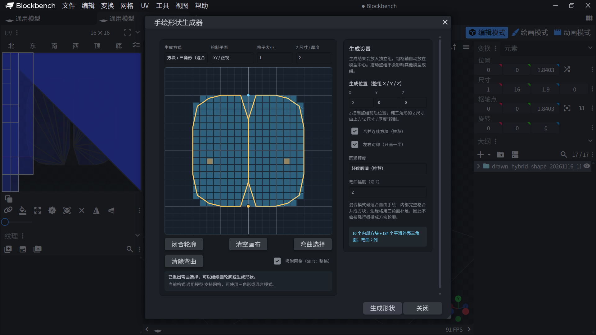
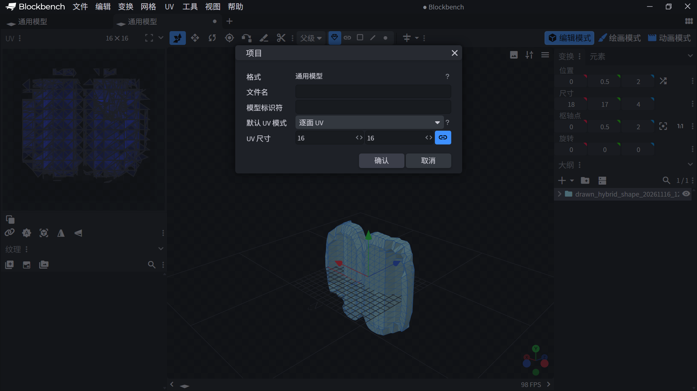

**中文** | [English](README_EN.md)

# Blockbench 手绘形状生成器

一个 Blockbench 插件：在网格上像画画一样拖出轮廓，闭合后立刻变成真实模型——可以生成像素小方块、三角网格，或两者混合，并支持左右对称、局部弯曲、局部宽度和按位置指定方块/三角面。

## 安装

1. 打开 Blockbench（开发和测试版本为 5.2.2，最低支持 5.0.0）。
2. 菜单 `文件 → 插件`。
3. 点 `从文件加载插件`（Load Plugin from File），选择本仓库的 `drawn_shape_tool.js`。
4. 在顶部 `工具` 菜单里点击 `手绘形状生成器`。

> 插件文件名必须保持为 `drawn_shape_tool.js`。

## 功能

- **自由手绘 + 轮廓闭合**：按住鼠标连续画线；松开只结束当前一笔，画回起点或点「闭合轮廓」后才填充生成。
- **四种生成方式**：
  - `小方块`：生成可编辑立方体，适用 Java Block/Item、Bedrock 及支持方块的项目，并会合并连续区域减少组件数。
  - `纯三角形（3 点）`：依次点三个角点生成直边三角形；Z 尺寸为 0 是单面，大于 0 生成可调厚度的三角柱。
  - `厚三角网格`：生成封闭、可设厚度的三角面网格，适用 `Generic Model / Free Model`。
  - `方块 + 三角形（混合）`：默认只生成一整块平滑三角外壳，勾选后额外加入内部方块。
- **左右对称**：只画中心线右半边，端点自动吸附中轴，闭合后精确镜像左侧（方块、三角外壳、弯曲/宽度/部位选区都会同步镜像）。
- **局部弯曲**：设置幅度与过渡宽度，涂抹需要弯曲的列（Alt 擦除），缓入缓出不变折；可选「弯曲后平滑回正」或单向斜坡。
- **局部宽度**：按列平滑加宽或收窄，支持过渡宽度与对称。
- **按位置混合**：把指定格子标记为方块或三角形，例如方块刀身 + 三角刀刃；相邻三角格会合并为连续区域。
- **视口取点**：点「在视口取点」后直接在 3D 视口点击放点（吸附网格，可贴到已有方块表面）：2 点连线、3 点成三角面、4 点生成包围它们的方块，配合工具条随时生成/撤销/清空。
- **其他参数**：格子大小、Z 厚度、绘制平面、整组 XYZ 位置、圆润程度（可关闭/轻度/中/高）。
- 生成结果放在新建的 `drawn_*_shape_*` 组中，枢轴在包围盒中心，可撤销、继续移动旋转、赋材质和做动画。

## 格式限制

Java Block/Item 的导出格式只包含 cuboid，不支持任意三角网格。插件会在该格式下禁用三角形和混合模式，避免模型在 Blockbench 里可见、导出后消失。

需要圆润的三角外形时，请新建 `Generic Model / Free Model` 项目，再用 OBJ / GLTF 等格式导出。

## 使用文档

- 中文详细说明：[docs/USAGE_ZH.md](docs/USAGE_ZH.md)
- English usage guide: [docs/USAGE_EN.md](docs/USAGE_EN.md)

## 版本

当前版本 **v1.13.0**，作者 k9-okio，标签：Modeling / Tools / Geometry。
