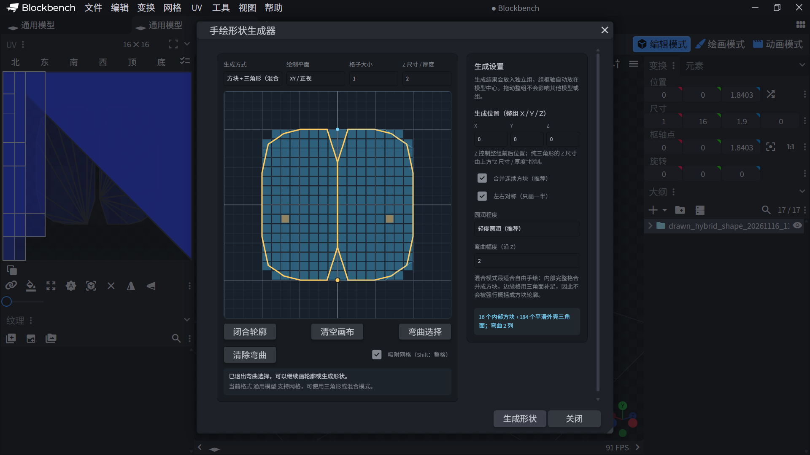
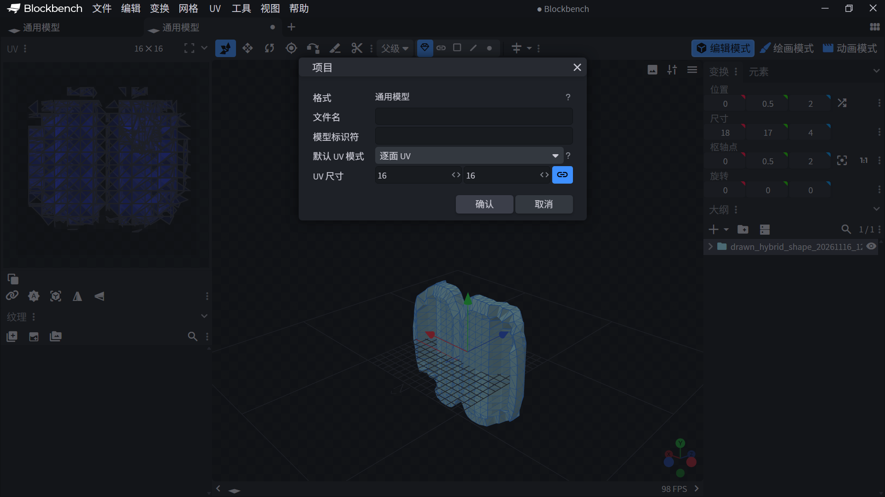

[中文](README.md) | **English**

# Blockbench Drawn Shape Tool

A Blockbench plugin that turns freehand strokes on a grid into real geometry. Draw an outline like you would sketch on paper, close it, and the plugin fills it with pixel-style cuboids, a triangle mesh, or a hybrid of both — with mirror symmetry, local bending, local width and per-region cube/triangle tags.

## Installation

1. Open Blockbench (developed and tested on 5.2.2, minimum 5.0.0).
2. Go to `File → Plugins`.
3. Click `Load Plugin from File` and select `drawn_shape_tool.js` from this repository.
4. Open the `Tools` menu and click `手绘形状生成器` (Drawn Shape Tool).

> The file must keep the name `drawn_shape_tool.js`.

## Features

- **Freehand drawing with outline closing**: hold the mouse button to draw strokes; releasing only ends the current stroke. The shape is not filled until you draw back to the start point or press `Close Outline`.
- **Four generation modes**:
  - `Small cubes`: editable cuboids for Java Block/Item, Bedrock and any format that supports cubes. Adjacent cells are merged to keep the component count low.
  - `Plain triangle (3 points)`: click three corners to build a flat, sharp triangle. With Z size 0 it is a single face; with Z size > 0 it becomes a triangular prism with adjustable thickness.
  - `Thick triangle mesh`: a closed triangle mesh with adjustable thickness, for `Generic Model / Free Model`.
  - `Cubes + triangles (hybrid)`: generates one smooth triangle shell by default; enable the internal-cube option to add cubes inside as well.
- **Mirror symmetry**: draw only the right half. Endpoints snap to the center axis and the left half is mirrored exactly, including cube fill, triangle shell, bend regions, width regions and region tags.
- **Local bending**: set bend amount and transition width, then paint the columns to bend (hold Alt to erase). The transition eases in and out instead of creasing, with an optional "return to straight" profile or a one-way slope.
- **Local width**: widen or narrow painted columns smoothly, with an adjustable transition width; mirrored automatically when symmetry is on.
- **Per-region cube/triangle mixing**: mark cells as cubes or triangles, e.g. a cube blade body with a triangle edge. Adjacent triangle cells merge into one continuous surface.
- **Viewport points**: press `在视口取点` (place points in viewport) and click directly in the 3D viewport. Points snap to the grid and stick to existing cube surfaces: 2 points make a thin line, 3 points a triangle face, 4 points the box enclosing them, with generate / undo / clear buttons in the floating bar.
- **Other parameters**: grid cell size, Z thickness, drawing plane, whole-group XYZ offset, and roundness (off / light / medium / high).
- Results are placed in a new `drawn_*_shape_*` group whose pivot sits at the bounding-box center, so the new geometry can be moved, rotated, textured and animated, and the operation can be undone.

## Format limitations

Java Block/Item only exports cuboids and cannot store arbitrary triangle meshes. In that format the plugin disables triangle and hybrid modes, so shapes never look correct in Blockbench but disappear after export.

For smooth triangle shapes, create a `Generic Model / Free Model` project and export via OBJ, GLTF or another format that supports meshes.

## Documentation

- Chinese usage guide: [docs/USAGE_ZH.md](docs/USAGE_ZH.md)
- English usage guide: [docs/USAGE_EN.md](docs/USAGE_EN.md)

## Version

Current version **v1.13.0** by k9-okio. Tags: Modeling / Tools / Geometry.
